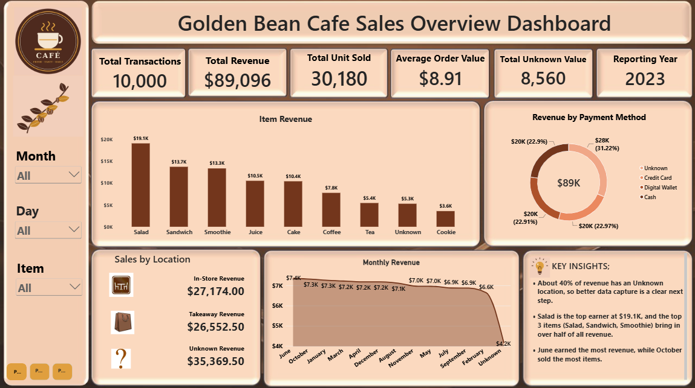
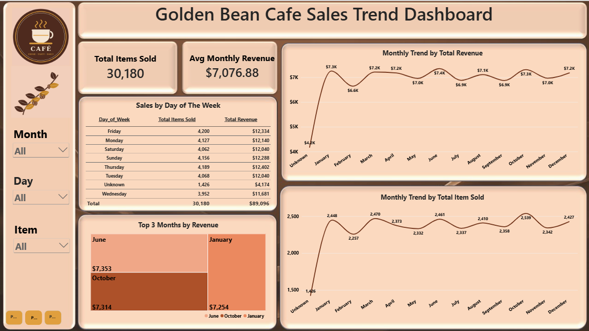
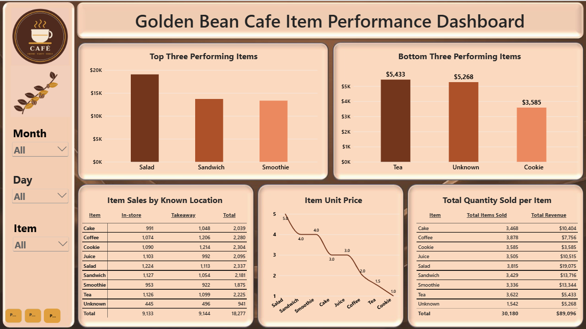

#  Golden Bean Café: Sales Trends and Item Performance Analysis

**An end-to-end data analytics project: Excel data cleaning → SQL business analysis → interactive Power BI dashboard**

---

##  Table of Contents
1. [Project Overview](#-project-overview)
2. Dashboard   Screenshots
3. [Business Problems](#-business-problems)
4. [Dataset](#-dataset)
5. [Tools Used](#-tools-used)
6. [Project Workflow](#-project-workflow)
7. [Methodology](#-methodology)
8. [Key Findings](#-key-findings)
9. [Recommendations](#-recommendations)
10. [Limitations](#-limitations)
11. [Author](#-author)

 ---

##  Project Overview

Golden Bean Café is a fictional café whose 2023 sales records came as a messy, raw spreadsheet with missing values, inconsistent entries and gaps across several columns.

This project takes that raw data through the full analytics process:

1. **Clean** it in Excel, with every fix documented in a cleaning log.
2. **Analyse** it in SQL Server by answering business questions.
3. **Visualise** it in Power BI with a three-page interactive dashboard.

The aim is to help the café owner understand **what sells, when it sells, how customers pay and where the data needs improving**.

## Dashboard Screenshots

### Overview


### Sales Trends


### Item Performance


---

##  Business Problems

Golden Bean Café's owner has a large, messy sales record but no clear answers to the questions that drive daily decisions:

1. **How is the café really performing?** There is no single view of total revenue, items sold or the value of an average order.
2. **When does the café earn the most?** It is unclear which months and days of the week bring in the most money, and whether selling more items always means earning more.
3. **What should be promoted or dropped?** The owner doesn't know which items drive revenue and which ones barely contribute.
4. **Where and how do customers buy?** The split between in-store and takeaway sales, and between payment methods, is not clear.
5. **Can the data be trusted?** Many records have missing or unknown values, which makes it hard to plan with confidence.

**This project answers these problems** by cleaning the data, analysing it with SQL and presenting the results in an interactive Power BI dashboard.---

##  Dataset

| Detail | Description |
|---|---|
| **File** | `original_Cafe_Sales.xlsx` |
| **Records** | 10,000 transactions |
| **Period** | January to December 2023 |
| **Items** | Cake, Coffee, Cookie, Juice, Salad, Sandwich, Smoothie, Tea |
| **Payment methods** | Cash, Credit Card, Digital Wallet |
| **Locations** | In-Store, Takeaway |


---

##  Tools Used

| Tool | Purpose |
|---|---|
| **Microsoft Excel** | Data cleaning, standardisation and the cleaning log |
| **SQL Server (SSMS)** | Business questions answered with SQL queries |
| **Power BI Desktop** | Data modelling, DAX measures and the interactive dashboard |
| **DAX** | Calculated measures for KPIs and rankings |
| **GitHub** | Documentation and portfolio |

---

##  Project Workflow

```
Raw data (Excel)  →  Cleaned data + Cleaning Log  →  SQL analysis  →  Power BI dashboard  →  Insights & recommendations
```

---

##  Methodology

| Step | Tool | What was done |
|---|---|---|
| **1. Clean** | Excel | Kept the original data in a **Raw** sheet, standardised missing and invalid values (labelled `Unknown` so no sales were lost), created `Year`, `Month_Num`, `Month_Name` and `Day_of_Week` from the date, verified `Total Spent`, and logged every fix in a **Cleaning_Log** sheet. |
| **2. Analyse** | SQL Server | Answered **eight business questions**, each with a query and a 1–2 line insight comment. |
| **3. Visualise** | Power BI | Built a **three-page dashboard** (Overview, Sales Trends, Item Performance) with DAX measures and slicers for Month, Day and Item. |

> **Why `Unknown` instead of deleting rows?** Dropping incomplete rows would have understated revenue. Labelling the gaps keeps totals accurate and makes the data quality problem visible.


---

##  Key Findings

**Overall performance**
- **Total revenue: $89,096** from **10,000 transactions** and **30,180 items sold**.
- **Average order value: $8.91.**
- **Average monthly revenue: about $7.08K.**

**Items**
- **Salad is the top earner at $19.1K.** Salad, Sandwich and Smoothie together bring in **over half of all revenue**.
- **Cookie is the lowest earner at $3.6K**, followed by Tea ($5.4K).
- Lower-priced items such as **Coffee and Tea sell in high volume** (about 4K units each) but earn less per sale than Salad.

**Time**
- **June** had the highest revenue and **October** sold the most items, so volume and revenue do not always peak together.
- Monthly revenue is **stable, between about $6.6K and $7.4K**, with **February** the weakest real month.
- **Thursday** had the highest revenue ($12.4K) and **Wednesday** the lowest ($11.7K). Daily differences are small.

**Location and payment**
- In-Store (**$27.2K**) and Takeaway (**$26.6K**) are almost equal.
- About **40% of revenue ($35.4K) has an Unknown location**, and roughly **31% has an Unknown payment method**.

---

##  Recommendations

1. **Fix data capture at the till.** Make location and payment method required fields. About 40% of revenue has no location, which limits what the café can learn.
2. **Protect and promote the best sellers.** Salad, Sandwich and Smoothie drive over half of revenue, so keep them well stocked and visible.
3. **Rethink or bundle weak items.** Pair Cookies and Tea with top sellers, for example "Salad + Tea", or review their price.
4. **Run a midweek offer.** Wednesday is the weakest day, so a promotion could lift it.
5. **Plan around volume as well as revenue.** Stock and staff for the months that sell the most items, not only the months that earn the most.
6. **Balance in-store and takeaway.** Sales are almost equal, so invest in both channels.

---

##  Limitations

- **Unknown values:** a large share of records has missing `Location`, `Payment Method`, `Item`, `Day` or `Month`. These were kept and labelled `Unknown`, and excluded from some visuals.
- **Single year:** the data covers 2023 only, so year-on-year growth cannot be measured.
- **No cost data:** the dataset has no cost column, so **COGS, profit and margin** cannot be calculated.
- **Small differences:** day-to-day and month-to-month differences are small, so conclusions about them should be treated carefully.

---


##  Author

**Esomchi Ezenwukwa**
   Data Analyst | Medical Student

📧 ezenwukwaesomchi@gmail.com
🔗 LinkedIn: *[ https://www.linkedin.com/in/esomchi-ezenwukwa-099923410?utm_source=share_via&utm_content=profile&utm_medium=member_android]*

This project showcases my ability to clean, analyze and visualize data to identify trends, solve business problems and support data-driven decisions. Through this project, I explored the sales performance of Golden Bean Café, carried out data cleaning and analysis, answered business questions using SQL, and developed an interactive Power BI dashboard to communicate key findings and insights.
       


